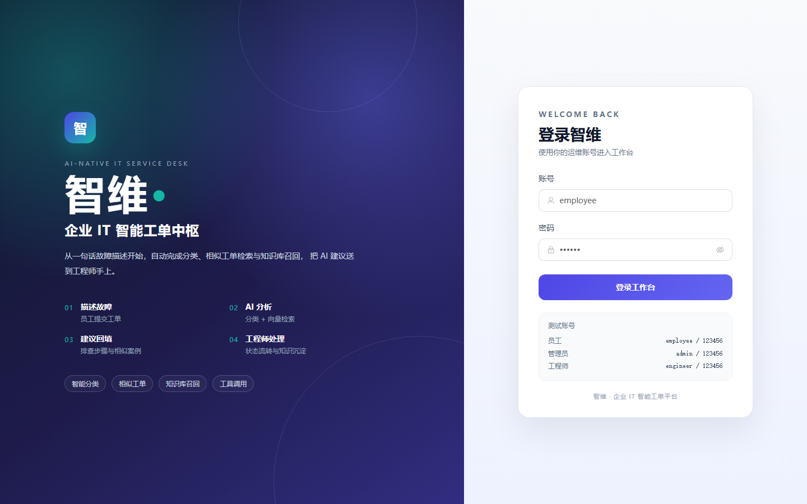
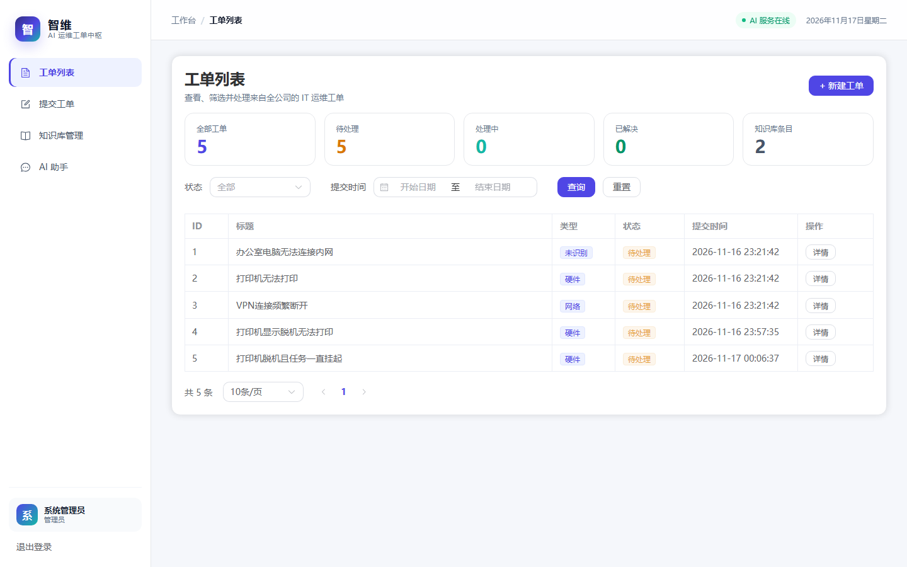
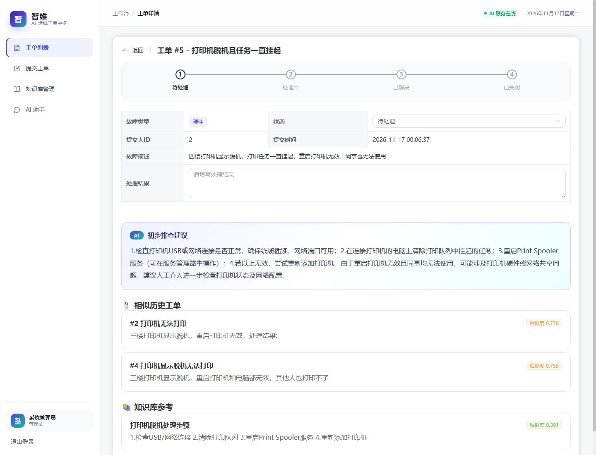
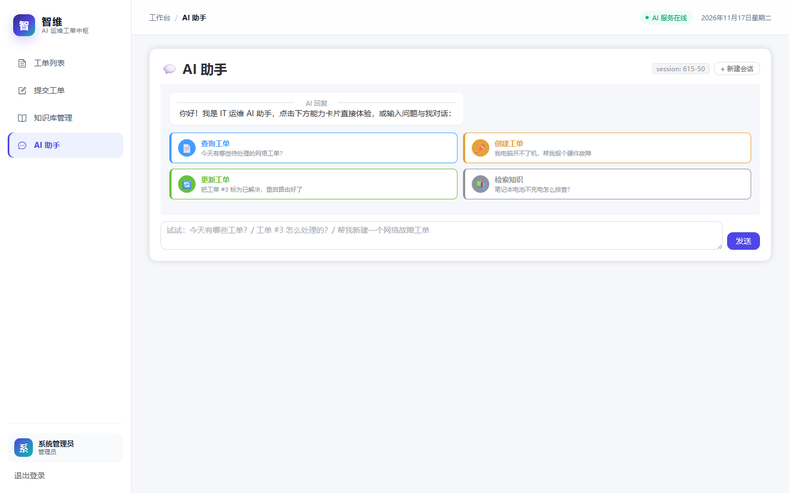
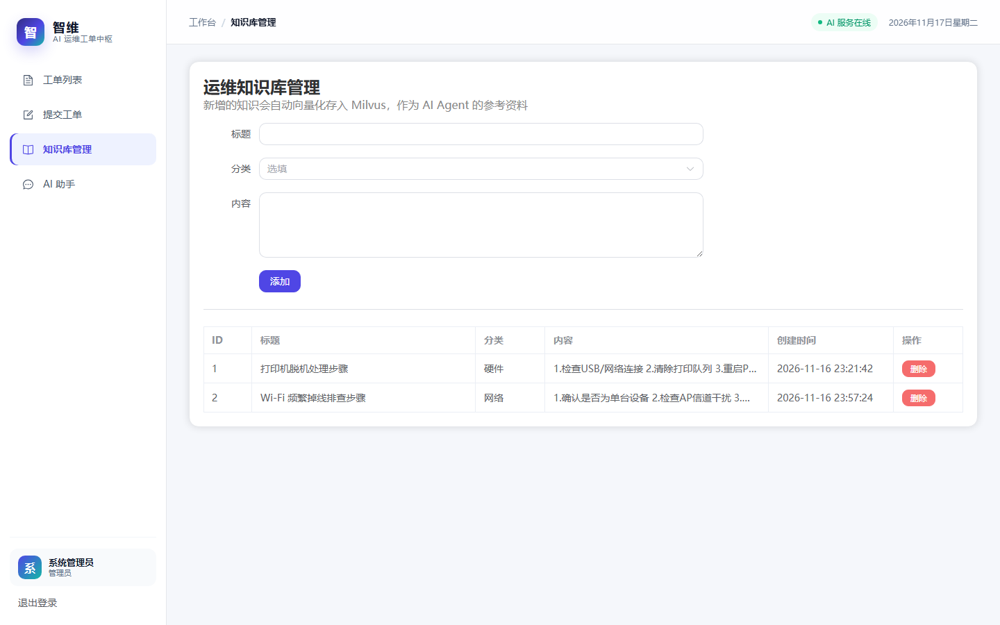

# 智维 · 企业 IT 智能工单平台

一个面向企业 IT 运维场景的智能工单系统：员工提交工单后，AI 自动识别故障类型、检索相似历史工单与知识库，并生成初步排查建议；运维人员可以在页面处理工单，也可以通过 AI 聊天助手用自然语言查询、创建和更新工单。

## 功能特性

- **工单管理**：提交、分页列表（支持状态/日期筛选）、详情查看、处理结果回填
- **AI 工单分析**：自动分类（网络/硬件/软件/账号）、相似工单检索、知识库召回、生成排查建议
- **知识库管理**：管理员新增/删除知识，MySQL 与 Milvus 双写；删除时同步清理向量
- **AI 聊天助手**：基于 Function Calling 的工具调用，可查询工单、查询知识库、创建工单、更新工单
- **登录鉴权**：Sa-Token 无状态令牌；Agent 通过内部令牌访问后端
- **向量检索**：Milvus COSINE 相似度检索，Embedding 使用本地 `all-MiniLM-L6-v2`（384 维）

## 界面预览

| 登录 | 工单列表 |
|---|---|
|  |  |

| 工单详情 | AI 助手 |
|---|---|
|  |  |



> 截图来自本地运行环境，测试账号见下方「访问系统」。

## 技术栈

| 层 | 技术 |
|---|---|
| 前端 | Vue 3、Vite、Element Plus、Vue Router、Axios |
| 后端 | Spring Boot 3.2、MyBatis-Plus 3.5.5、Sa-Token 1.40、FastJSON2 |
| AI Agent | FastAPI、LangChain 1.3、LangGraph、langchain-openai |
| 大模型 | OpenAI 兼容接口（当前配置为 DeepSeek `deepseek-chat`） |
| 向量库 | Milvus 2.6.7（standalone，Docker） |
| 数据库 | MySQL 8.0 |
| Embedding | sentence-transformers `all-MiniLM-L6-v2`（本地） |

## 系统架构

```
┌──────────────┐      /api 代理       ┌────────────────────┐
│  Vue 前端     │ ───────────────────▶ │ Spring Boot 后端     │
│  :5173       │                      │ :8080  context=/api │
└──────────────┘                      └─────────┬──────────┘
                                                │ MyBatis-Plus
                                                ▼
                                         ┌───────────────┐
                                         │   MySQL 8     │
                                         │ zhiwei_ticket │
                                         └───────────────┘
                                                ▲
                         内部令牌 AGENT_TOKEN       │ 工具类请求（查/改工单）
                                                │
┌──────────────┐      HTTP /analyze     ┌───────┴──────────┐
│ Spring Boot  │ ─────────────────────▶ │ FastAPI AI Agent │
│ AgentClient  │                        │ :8000            │
└──────────────┘                        └───────┬──────────┘
                                                │ Embedding + 向量检索
                                                ▼
                                         ┌──────────────┐
                                         │ Milvus :19530│
                                         └──────────────┘
                                                │
                                                ▼
                                         ┌──────────────┐
                                         │ DeepSeek LLM │
                                         └──────────────┘
```

## 目录结构

```
智维 · 企业 IT 智能工单平台/
├── code/
│   ├── ticket-backend/     # Spring Boot 业务后端（:8080）
│   ├── ticket-frontend/    # Vue 3 前端（:5173）
│   └── ticket-agent/       # FastAPI AI Agent（:8000）
├── scripts/                # 一键启动/关闭脚本
├── sql/                    # 数据库初始化脚本
├── 一键启动.bat
├── 一键关闭.bat
└── README.md
```

## 环境要求

- JDK 17 + Maven 3.9+
- Node.js 20.19+ 或 22.12+（实测 v24）
- Python 3.12+（实测 3.12.10）
- MySQL 8.0
- Docker Desktop + WSL2（Windows 下运行 Milvus 必需）
- Milvus 镜像 `milvusdb/milvus:v2.6.7`
- 可访问的 OpenAI 兼容大模型服务（默认 DeepSeek）

## 一键启动 / 关闭（Windows）

项目根目录提供两个批处理文件，适合本地开发时快速启动/停止：

| 文件 | 作用 |
|---|---|
| `一键启动.bat` | 检查 MySQL → 启动 Docker Desktop（如未运行）→ 启动 Milvus → 启动 Agent → 后端 → 前端，并打开浏览器 |
| `一键关闭.bat` | 停止前端、后端、Agent 和 Milvus 容器；MySQL 与 Docker Desktop 保持运行 |

使用前确认：

- MySQL 已安装并已运行；
- Docker Desktop 已安装，且已创建 `milvus-standalone` 容器；
- Agent 的 `.venv` 已创建（脚本不会自动创建 Python 虚拟环境）；
- 首次启动时如果后端 jar 不存在，脚本会尝试执行 `mvn -DskipTests package`；
- 前端 `node_modules` 不存在时，脚本会尝试执行 `npm install`。

运行日志和 PID 文件会写入 `.run/`（已加入 `.gitignore`）。如果 5173 / 8080 / 8000 被其他程序占用，脚本会提示并跳过；先关闭占用进程，或运行 `一键关闭.bat` 后再启动。

> Docker Desktop 的默认查找路径是 `C:\Program Files\Docker\Docker\Docker Desktop.exe`，另外兼容本机的 `G:\develop2\Docker\Docker Desktop.exe`。如果安装在其他位置，请修改 [scripts/start-all.ps1](scripts/start-all.ps1) 里的 `$dockerDesktopCandidates`。
>
> 本机实测：`docker stop` 后 Milvus 可能以 exit 134 退出，但数据卷保留，集合数据不受影响；下一次 `一键启动.bat` 会自动拉起并等待健康检查。若启动失败，脚本会打印 Milvus 最近日志。

## 快速开始

### 1. 初始化数据库

用 root 登录 MySQL，执行项目根目录下的初始化脚本：

```bash
mysql -uroot -p123456 --default-character-set=utf8mb4 < sql/init.sql
```

脚本会创建 `zhiwei_ticket` 库、三张表和示例数据；三个账号的密码统一为 `123456`。

> `id=3` 的用户需要存在：`SaTokenConfig` 收到 Agent 的内部令牌时固定以 `loginId=3` 登录。

### 2. 启动 Milvus

确认 Docker Desktop 已启动（Windows 还需启用 WSL2）：

```bash
# 前提：本机已安装 Docker Desktop 与 Milvus 2.6.7 standalone
# 首次使用需先导入镜像（镜像文件按实际存放位置调整）
docker load -i <milvus_image.tar>

# 启动已创建的容器
docker start milvus-standalone

# 如果还没有容器，请按 Milvus 官方文档启动 standalone
```

健康检查：`docker ps` 中 `milvus-standalone` 显示 `(healthy)`，端口 `19530` / `9091` / `2379`。

可选：安装 Attu，用图形化界面查看向量数据。

### 3. 启动后端

```bash
cd code/ticket-backend
mvn -DskipTests package
java -jar target/zhiwei-ticket-backend-1.0.0.jar
```

- 端口：`8080`
- 统一前缀：`/api`
- 修改代码后需要重新 `package`

### 4. 启动前端

```bash
cd code/ticket-frontend
npm install
npm run dev
```

- 访问：http://localhost:5173
- Vite 已配置代理：`/api` → `http://127.0.0.1:8080`

### 5. 启动 AI Agent

```bash
cd code/ticket-agent

# Windows
python -m venv .venv
.venv\Scripts\python.exe -m pip install --no-deps -r requirements.lock.txt -i https://pypi.tuna.tsinghua.edu.cn/simple
.venv\Scripts\python.exe -m uvicorn app.main:app --host 0.0.0.0 --port 8000

# Linux/macOS
python3 -m venv .venv
.venv/bin/python -m pip install --no-deps -r requirements.lock.txt -i https://pypi.tuna.tsinghua.edu.cn/simple
.venv/bin/python -m uvicorn app.main:app --host 0.0.0.0 --port 8000
```

> `requirements.lock.txt` 是 Windows + Python 3.12 实测环境的完整依赖快照。`--no-deps` 会跳过 pip 的依赖解析，避免 `torch/transformers` 版本回溯导致安装卡住。换平台或升级 Python 后，建议基于 `requirements.txt` 重新生成 lock。

首次进行向量化时会加载 `app/models` 下的本地 Embedding 模型，需要几秒到十几秒。

### 6. 访问系统

打开 http://localhost:5173 ，使用测试账号登录：

| 账号 | 密码 | 角色 |
|---|---|---|
| `admin` | `123456` | 管理员（可管理知识库） |
| `employee` | `123456` | 普通员工 |
| `engineer` | `123456` | 运维工程师 |

> 端口说明：本项目默认使用 `8080` / `5173` / `8000`。如需同时运行多个工单项目，请先停掉占用端口的进程或修改端口，避免端口冲突。

## 配置说明

### 后端 `code/ticket-backend/src/main/resources/application.yml`

```yaml
spring:
  datasource:
    url: jdbc:mysql://localhost:3306/zhiwei_ticket?...
    username: root
    password: 123456

sa-token:
  token-name: Authorization
  token-prefix: Bearer
  timeout: 2592000            # 30 天

agent:
  token: zhiwei-internal-2026-change-me   # 必须与 Agent 的 AGENT_TOKEN 一致
  base-url: http://localhost:8000
```

### Agent `code/ticket-agent/.env`

```env
# 大模型（OpenAI 兼容协议，当前为 DeepSeek）
OPENAI_API_KEY=sk-你的Key
OPENAI_BASE_URL=https://api.deepseek.com/v1
LLM_MODEL=deepseek-chat
LLM_TEMPERATURE=0.2

# Milvus
MILVUS_HOST=127.0.0.1
MILVUS_PORT=19530
MILVUS_KNOWLEDGE=zhiwei_knowledge
MILVUS_TICKET=zhiwei_ticket
KNOWLEDGE_MIN_SCORE=0.3      # 知识库相似度下限（COSINE，中文场景建议 0.3）

# 本地 Embedding 模型快照路径（按实际位置修改）
EMBEDDING_MODEL="<项目路径>/code/ticket-agent/app/models/models--sentence-transformers--all-MiniLM-L6-v2/snapshots/1110a243fdf4706b3f48f1d95db1a4f5529b4d41"

# 反向调用 Spring Boot
SPRING_BOOT_BASE_URL=http://localhost:8080
AGENT_TOKEN=zhiwei-internal-2026-change-me   # 必须与后端 agent.token 一致
```

> 换成其他 OpenAI 兼容服务时，只需改 `OPENAI_BASE_URL` 和 `LLM_MODEL`，例如通义千问 `https://dashscope.aliyuncs.com/compatible-mode/v1` + `qwen-plus`，智谱 `https://open.bigmodel.cn/api/paas/v4` + `glm-4-flash`。

## 核心流程

### 工单智能分析

1. 前端提交工单 → 后端 `POST /api/ticket` 写入 MySQL（状态 `PENDING`）
2. 后端 `AgentClient` 调用 Agent `POST /analyze`
3. Agent：
   - 若工单未指定故障类型，调用 LLM 分类
   - 加载 Embedding 模型，分别检索 `zhiwei_knowledge` / `zhiwei_ticket` 两个 Milvus 集合
   - 把检索结果拼进 Prompt，让 LLM 输出 JSON（故障类型 + 排查建议）
   - 将本工单写入 `zhiwei_ticket` 集合，供后续相似检索
4. 后端把 AI 结果回填到工单（`ai_suggestion` / `similar_*` / `fault_type`）

### 知识库同步

1. 管理员新增知识 → 后端写入 MySQL，拿到自增 ID
2. 后端调用 Agent `POST /knowledge/add` → 向量化后写入 Milvus `zhiwei_knowledge`
3. 删除知识时，后端删除 MySQL 记录并调用 Agent `DELETE /knowledge/{id}` 同步删除向量

### AI 助手工具调用

- 前端 `POST /api/chat` → 后端转发 Agent `POST /chat`
- Agent 使用 LangChain `create_agent` + 原生 Function Calling
- 工具通过 `AGENT_TOKEN` 反向调用后端接口，包括：
  - 读：`list_tickets`、`get_ticket_detail`、`query_knowledge`、`query_history_tickets`
  - 写：`create_ticket`、`update_ticket`（返回结果中标记 `needs_confirm`）
- 会话历史按 `session_id` 保存在 Agent 进程内存中

## API 一览

### Spring Boot（前缀 `/api`）

| 方法 | 路径 | 说明 |
|---|---|---|
| POST | `/user/login` | 登录，返回 token |
| GET | `/ticket` | 工单分页（page/size/status/dateFrom/dateTo） |
| POST | `/ticket` | 提交工单并触发 AI 分析 |
| GET | `/ticket/{id}` | 工单详情 |
| PUT | `/ticket/{id}` | 更新处理结果/状态 |
| GET | `/knowledge` | 知识库列表 |
| POST | `/knowledge` | 新增知识并同步向量库 |
| DELETE | `/knowledge/{id}` | 删除知识并同步删除向量 |
| POST | `/chat` | AI 聊天 |

除 `/user/login` 外，请求头需带 `Authorization: Bearer <token>`。

### FastAPI Agent（端口 8000）

| 方法 | 路径 | 说明 |
|---|---|---|
| GET | `/` | 健康检查 |
| POST | `/analyze` | 工单智能分析 |
| POST | `/knowledge/add` | 新增知识向量 |
| DELETE | `/knowledge/{id}` | 删除知识向量 |
| POST | `/chat` | AI 聊天（工具调用） |
| POST | `/ticket` | 更新工单向量 |

## 常见问题

**1. 接口返回 401 / 无效 token**
检查 `.env` 的 `AGENT_TOKEN` 与 `application.yml` 的 `agent.token` 是否完全一致。

**2. AI 建议固定显示“AI 暂不可用，请人工处理”**
- 检查 `OPENAI_API_KEY` 是否有效、账户是否有余额
- 检查 `OPENAI_BASE_URL` / `LLM_MODEL` 是否正确
- 修改 `.env` 后必须重启 Agent 进程

**3. Milvus 连接失败**
- 确认 Docker Desktop 已启动，Windows 下 WSL2 正常：`wsl --status`
- 确认容器健康：`docker ps`，必要时 `docker start milvus-standalone`
- 确认 19530 端口未被占用

**4. 中文知识检索命中率低**
内置 Embedding 模型 `all-MiniLM-L6-v2` 主要面向英文，中文相似度偏低（实测相关文本约 0.36–0.4）。项目默认把 `KNOWLEDGE_MIN_SCORE` 调为 `0.3`，保证测试时能召回；生产环境建议替换为中文 Embedding 模型（同时需要把 `vector_store.py` 的 `VECTOR_DIM` 改成新模型维度）。

**5. Windows 命令行 curl 提交中文报 `Invalid UTF-8 start byte`**
Windows 自带 curl 会把命令行参数按 GBK 发送。请把 JSON 写入 UTF-8 文件后用 `curl --data-binary @file.json`，或改用 Python `requests` 测试。

**6. 前端请求 404 / 跨域**
确认后端运行在 8080 且 `context-path=/api`，前端通过 Vite 代理访问，不要直连 8080 以外的地址。

**7. 开机后服务没起来**
MySQL 是 Windows 服务会自启；Docker Desktop 和 Milvus 不会自动启动，需要手动：
```bash
# 启动 Docker Desktop 后
docker start milvus-standalone
```
后端、前端、Agent 也需要分别按上面的命令启动。

**8. `pip install -r requirements.txt` 卡住**
`torch/transformers` 是 `sentence-transformers` 的传递依赖，未锁定版本时 pip 会反复回溯。改用完整锁文件安装：

```bash
.venv\Scripts\python.exe -m pip install --no-deps -r requirements.lock.txt -i https://pypi.tuna.tsinghua.edu.cn/simple
```

## 安全说明

- `.env` 中含大模型密钥和内部令牌，已被 `.gitignore` 忽略，**不要提交到 Git**。
- 测试账号密码为明文，仅用于本地开发环境，生产环境请改为加密存储并强制修改默认密码。
- `AGENT_TOKEN` 是固定内部令牌，生产环境建议改为随机长字符串并定期轮换。
